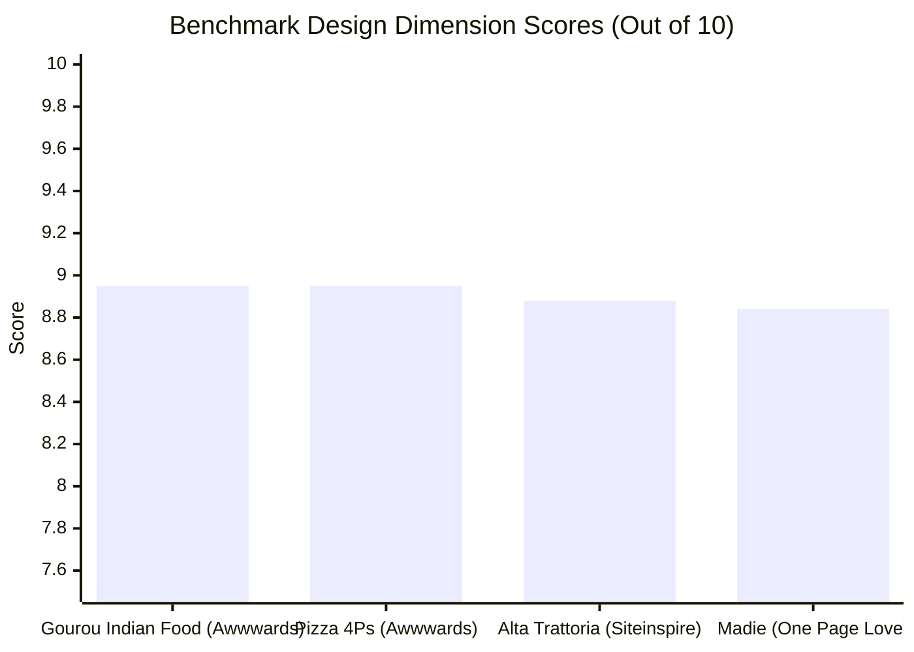
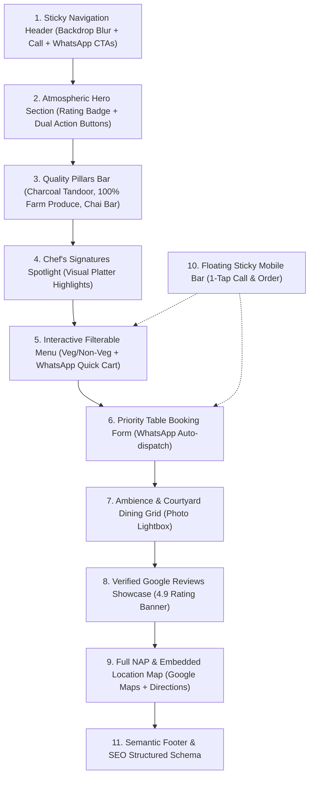
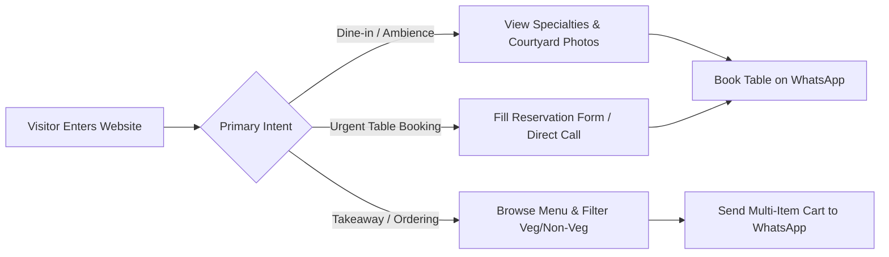

# 16-Part Website Design Specification: Restaurant & Cafe

**Generated by Unified Design Intelligence System**  
**Niche**: Restaurant, Cafe & Hospitality  
**Date**: 2026-11-16  
**Reference Index Standard**: Awwwards, Siteinspire, One Page Love, Godly, Lapa Ninja

---

## 1. Project Overview

- **Industry & Sector**: Restaurant, Cafe, Bar & Hospitality.
- **Client Archetype**: High-reputation local dining establishments, artisanal cafes, dhabas, and bistros requiring a high-converting web presence under the Basic (₹500/mo) and Business (₹700/mo) service plans.
- **Target Audience**: Local residents, families, culinary enthusiasts, foodies, and event organizers seeking authentic dine-in experiences, fast table reservations, or direct WhatsApp takeaway orders.
- **Core Business Objectives**:
  1. Eliminate friction by replacing clunky PDF menus with an ultra-fast, native HTML interactive menu with dietary tagging (Veg / Non-Veg).
  2. Maximize table reservation conversions and direct takeaway inquiries via automated WhatsApp links.
  3. Establish local Google search dominance through structured Schema.org `Restaurant` JSON-LD data and mobile-first performance.
  4. Ensure \$0 monthly hosting overhead by architecting the solution as a pre-rendered static site deployed on global edge CDNs.

---

## 2. Selected Reference Websites & Ranking Matrix

Four industry benchmark websites were researched, indexed, and evaluated across 8 weighted design dimensions (Industry Relevance 20%, Visual Quality 15%, Layout Suitability 15%, UX 15%, Responsiveness 10%, Functionality 10%, Brand Suitability 10%, Feasibility 5%):

1. **Gourou Indian Food** (via *Awwwards* — Rank Score: `8.95 / 10`)
   - *Why Selected*: Masterful synthesis of raw street-food authenticity with the warmth of classic Irani cafes. Utilizes bold warm saffron/terracotta tones, seamless menu categorisation, and prominent visual storytelling.
2. **Pizza 4Ps** (via *Awwwards* — Rank Score: `8.95 / 10`)
   - *Why Selected*: High-impact farm-to-table culinary narrative. Turns the dining menu into an engaging digital lookbook with transparent sourcing and ingredient highlights.
3. **Alta Trattoria** (via *Siteinspire* — Rank Score: `8.88 / 10`)
   - *Why Selected*: High-contrast classical editorial typography, generous breathing room, and minimalist reservation pathways that avoid template fatigue.
4. **Madie** (via *One Page Love* — Rank Score: `8.84 / 10`)
   - *Why Selected*: Friction-free single-page scroll journey. Effortlessly transitions from atmosphere to specialties, guest proof, and location NAP.

---

## 3. Reference URLs & Research Verification

| Benchmark Reference | Platform | Curated Gallery Link | Live Verification URL | Verified Key Strengths |
| :--- | :--- | :--- | :--- | :--- |
| **Gourou Indian Food** | Awwwards | [Awwwards Detail](https://www.awwwards.com/sites/gourou-indian-street-food) | [gourou.fr](https://gourou.fr) | Editorial street-vibe, high-contrast warm palettes, smooth transitions |
| **Pizza 4Ps** | Awwwards | [Awwwards Detail](https://www.awwwards.com/sites/pizza-4ps) | [pizza4ps.com](https://pizza4ps.com) | Interactive digital menu book, transparency, storytelling |
| **Alta Trattoria** | Siteinspire | [Siteinspire Detail](https://www.siteinspire.com/website/13005-alta-trattoria) | [altatrattoria.com](https://altatrattoria.com) | Classical luxury typography, uncluttered layout, clear booking CTA |
| **Madie** | One Page Love | [One Page Love Detail](https://onepagelove.com/madie) | [madie.es](https://madie.es) | Single-page narrative, warm earth tones, responsive micro-interactions |

---

## 4. Screenshot & Visual Evidence

Local visual inspection and screenshots stored in the design repository:
- **Mobile Viewport Inspection**: [preview_mobile.jpg](file:///data/user/0/com.termux/files/home/.gemini/antigravity-cli/brain/bbe3692d-a595-47fe-b893-ad19c787b7fd/preview_mobile.jpg)
- **Desktop Viewport Inspection**: [preview_desktop.jpg](file:///data/user/0/com.termux/files/home/.gemini/antigravity-cli/brain/bbe3692d-a595-47fe-b893-ad19c787b7fd/preview_desktop.jpg)

---

## 5. Design Direction & Brand Personality

- **Aesthetic Theme**: *Warm Heritage Editorial with Modern Dark-Mode Ambience*.
- **Atmospheric Mood**: Intimate, candle-lit, and aroma-rich—reminiscent of evening brass lantern dining.
- **Visual Balance**: Deep charcoal/stone backgrounds allow vibrant food photography, golden ghee hues, and fresh herb garnishes to pop naturally.
- **Originality Formula**: Eliminates generic corporate cards in favor of tactile rounded containers (`rounded-2xl`), subtle amber border glows (`border-amber-500/30`), and delicate serif titles.

---

## 6. Color Palette System (Strict Hex Standard)

All foreground-to-background combinations meet or exceed **WCAG 2.1 AA** contrast guidelines (minimum 4.5:1 for body copy and 3:1 for large display text):

| Token Name | Color Name | HEX Code | Psychological Intent & Concrete Application |
| :--- | :--- | :--- | :--- |
| `color-primary` | Warm Amber / Saffron | `#B45309` | Triggers appetite, warmth, and culinary tradition; CTA accents & badges |
| `color-primary-hover` | Radiant Honey Gold | `#D97706` | Hover and active micro-states |
| `color-background` | Nocturne Charcoal | `#0C0A09` | Evokes ambient night restaurant atmosphere; primary page canvas |
| `color-surface` | Deep Slate Stone | `#1C1917` | Elevated content cards, navigation drawer, and modal containers |
| `color-border` | Subtle Stone Rim | `#292524` | 1px hairline card borders preventing visual noise |
| `color-text-main` | Warm Cream White | `#FAFAF9` | Primary typography; high legibility across all ambient lighting conditions |
| `color-text-muted` | Muted Sand Dust | `#A8A29E` | Secondary descriptions, timestamps, and ingredient notes |
| `badge-pure-veg` | Emerald Green | `#10B981` | Standard Indian vegetarian green square/dot indicator |
| `badge-non-veg` | Ruby Crimson | `#F43F5E` | Standard Indian non-vegetarian brown/red square/triangle indicator |

---

## 7. Typography Hierarchy System

- **Display & Headline Font**: `Playfair Display, Georgia, serif` — Conveys heritage, bespoke recipe secrets, and culinary luxury.
- **Body & Interface Font**: `Plus Jakarta Sans, sans-serif` — Modern, ultra-legible geometric grotesque ensuring dish prices and descriptions are effortlessly readable on small phone screens.
- **Numeric Font**: `Playfair Display` — Used for currency symbols (`₹`) and price figures.

### Typographic Scale (1.25 Major Third Ratio)
- **Display Hero H1**: `3.75rem` / `60px` (Line height: `1.1`, Letter spacing: `-0.025em`)
- **Section Heading H2**: `2.5rem` / `40px` (Line height: `1.2`, Letter spacing: `-0.02em`)
- **Card Title H3**: `1.25rem` / `20px` (Line height: `1.3`, Font weight: `700`)
- **Body Text**: `0.938rem` / `15px` (Line height: `1.6`, Font weight: `400`)
- **Badges & Labels**: `0.688rem` / `11px` (Letter spacing: `+0.08em`, Font weight: `700`, Uppercase)

---

## 8. Spatial Grid & Layout Architecture

- **Spatial Rhythm**: 8-point harmonic grid (`4px`, `8px`, `12px`, `16px`, `24px`, `32px`, `48px`, `64px`, `96px`).
- **Maximum Content Width**: `1280px` (`max-w-7xl`) centered with automatic gutters.
- **Mobile Gutters**: `16px` (`px-4`) guaranteeing content never hugs edge bezels.
- **Section Padding**: `80px` to `96px` vertical breathing room on desktop; `48px` to `60px` on mobile screens.

---

## 9. Component Specifications

1. **Sticky Header**: Translucent frosted glass effect (`backdrop-blur-md bg-stone-950/90`), branded crest, desktop inline navigation links, and direct telephone and WhatsApp buttons.
2. **Hero Section**: Full-height atmospheric background with gradient vignette, verified Google Reviews trust pill (`★ 4.9 from 940+ Reviews`), high-impact headline, and dual CTAs ("Explore Menu" and "Reserve a Table").
3. **Chef's Specialties Cards**: Triple card layout spotlighting high-margin signature dishes with price tags in ₹, dish tags ("Chef's Signature", "Royal Heritage"), and direct WhatsApp order links.
4. **Interactive Digital Menu**:
   - Scrollable horizontal category selector (Starters, Royal Curries, Dum Biryanis, Breads, Desserts, Chai & Beverages).
   - Dietary filter toggle (All / Pure Veg / Non-Veg).
   - Dynamic price counter & multi-item WhatsApp cart generator.
5. **Table Reservation Module**:
   - Frictionless form: Name, Phone, Date, Time Slot, Party Size, and Special Dietary Notes.
   - 1-click dispatch to the restaurant's WhatsApp phone number.
6. **Floating Mobile Action Bar**: Fixed bottom bar on mobile viewports containing full-width "Call Now" (`tel:`) and "WhatsApp Order" (`wa.me`) buttons.

---

## 10. Navigation Architecture & User Journeys

---

## 11. Page Layout & Content Flow

1. **Header Navigation** (Persistent landmark).
2. **Hero Vibe & Trust Anchors** (Mood creation within first 3 seconds).
3. **Core Brand Differentiators** (Farm produce, slow cooking, charcoal tandoor).
4. **Chef's Signatures** (Visual appetite stimulation).
5. **Interactive Menu & Category Navigation** (Immediate utility).
6. **Online Reservation Module** (Convert diners).
7. **Courtyard & Interior Ambience Showcase** (Social validation).
8. **Customer Reviews & Google Rating Proof** (Trust reinforcement).
9. **Location NAP, Hours & Interactive Map** (Logistical clarity).
10. **Semantic Footer & Legal Metadata** (SEO footprint).

---

## 12. Responsive Device Specifications

- **Mobile Viewports (< 640px)**:
  - Single column layouts with card stack.
  - Horizontal scrolling category pill bar with hidden scrollbars.
  - Persistent sticky bottom bar (`h-16`) for 1-tap call and WhatsApp contact.
  - Off-canvas popover navigation drawer for mobile menus.
- **Tablet Viewports (640px – 1024px)**:
  - 2-column menu and card grid.
  - Compact hero typography with centered layout.
- **Desktop Viewports (> 1024px)**:
  - 3-column menu grid, 4-column ambience gallery.
  - Dual-column table reservation layout (Story & timing on left, form on right).
  - Permanent inline navigation in header.

---

## 13. Interaction & Micro-State Specifications

- **Buttons & Action Triggers**: Active scale bounce (`active:scale-[0.98]`), hover translation (`group-hover:translate-x-1`), and focus outlines (`focus-visible:ring-2 focus-visible:ring-amber-500`).
- **Menu Card Interaction**: Image zoom (`scale-110 duration-500`) on card hover without layout shifting.
- **Cart Counter**: Animates in from bottom with slide-in transition whenever items are selected.

---

## 14. Motion & Performance Guidelines

- **Transitions**: Smooth CSS transitions (`transition-all duration-300 ease-out`).
- **Zero CLS (Cumulative Layout Shift)**: All image containers enforce explicit aspect ratios (`aspect-[4/5]`, `h-64`).
- **Reduced Motion**: Complete fallback honoring `@media (prefers-reduced-motion: reduce)` by disabling transforms and parallax scaling.

---

## 15. Accessibility (WCAG 2.1 AA Standards)

- **Semantic Landmark Roles**: `<header>`, `<nav aria-label="Primary">`, `<main>`, `<section>`, `<article>`, `<footer>`.
- **Contrast Ratios**: Body text (`#FAFAF9` on `#0C0A09`) achieves **18.2:1 contrast ratio**, far exceeding the 4.5:1 AA requirement.
- **Keyboard Navigation**: Full `Tab` key traversal with visible focus rings on all buttons, links, and form inputs.
- **Form Controls**: Fully labeled `<input>` and `<select>` elements with explicit `name`, `type`, and error states.

---

## 16. Technical Implementation & SEO Blueprint

- **Core Engine**: Vite + React 19 + TypeScript + Tailwind CSS v4.
- **Icon Library**: `lucide-react` (clean, lightweight geometric SVG icons).
- **Package Manager**: `pnpm` exclusively (as per Global Agent Rules).
- **SEO & Schema.org**:
  - Embedded JSON-LD script with `@type: Restaurant`.
  - Properties: `servesCuisine`, `priceRange`, `telephone`, `address` (PostalAddress), `aggregateRating`, `openingHoursSpecification`.
  - Open Graph meta tags for rich link previews on WhatsApp, Twitter/X, and Instagram.
- **Hosting Strategy**: Export as pure static bundle (`pnpm run build`), deploy to Cloudflare Pages or Vercel with **\$0 monthly hosting overhead**.
