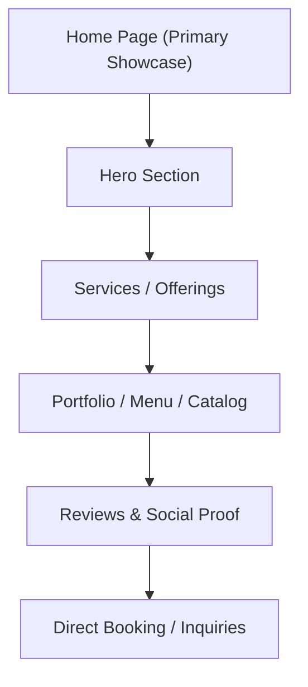

# Website Design Specification: Maison Ember Royal Indian Gastronomy
**Generated by Unified Design Intelligence System** | Date: 2026-11-16

## 1. Project Overview
- **Client / Project Name**: Maison Ember Royal Indian Gastronomy
- **Target Industry**: Restaurant
- **Target Audience**: Fine dining guests and gourmands
- **Primary Strategic Goal**: Showcase luxury menu, wine cellar, and drive instant table bookings
- **Development Scope**: Multi-section responsive modern web application.

## 2. Selected Reference Websites
The following curated references were analyzed and selected to inform the visual, layout, and UX strategy:
1. **Alta Trattoria** (via Siteinspire) — *Score: 8.88*
   - **Why Selected**: Direct industry match for 'Restaurant'. Curated design standard validated by Siteinspire. Clean visual hierarchy and logical user journey. Mobile-first architecture with verified responsive structure. Standard modern frontend stack without proprietary black-box dependencies.
2. **Madie** (via One Page Love) — *Score: 8.84*
   - **Why Selected**: Direct industry match for 'Restaurant'. Clean visual hierarchy and logical user journey. Mobile-first architecture with verified responsive structure. Demonstrated technical features (GSAP, Next.js, Prismic). Standard modern frontend stack without proprietary black-box dependencies.

## 3. Reference URLs
| Reference | Platform | Research / Gallery Link | Live Site URL |
| :--- | :--- | :--- | :--- |
| Alta Trattoria | Siteinspire | [https://www.siteinspire.com/website/13005-alta-trattoria](https://www.siteinspire.com/website/13005-alta-trattoria) | [https://altatrattoria.com](https://altatrattoria.com) |
| Madie | One Page Love | [https://onepagelove.com/madie](https://onepagelove.com/madie) | [https://madie.es](https://madie.es) |

## 4. Screenshot References
Screenshots captured and stored in the local intelligence repository:
### Alta Trattoria
- *Live interactive inspection performed via Browser MCP.*

### Madie
- *Live interactive inspection performed via Browser MCP.*

## 5. Design Direction
- **Aesthetic Theme**: Editorial Modernity with Clean High-Contrast Hierarchy.
- **Tone of Voice**: Sophisticated, trustworthy, intuitive, and conversion-focused.
- **Visual Balance**: Generous whitespace with deliberate focal points, avoiding cluttered generic template patterns.
- **Originality Note**: Incorporates the proven UX flows from references while using custom visual assets, proprietary layout styling, and distinct branding.

## 6. Color Palette (Strict Hex System)
| Role | Color Name | HEX Code | Usage |
| :--- | :--- | :--- | :--- |
| `primary` | Branded Primary | `#1E293B` | Core primary application |
| `secondary` | Branded Secondary | `#475569` | Core secondary application |
| `accent` | Branded Accent | `#2563EB` | Core accent application |
| `background` | Branded Background | `#F8FAFC` | Core background application |
| `surface` | Branded Surface | `#FFFFFF` | Core surface application |
| `text_primary` | Branded Text_Primary | `#0F172A` | Core text_primary application |
| `text_muted` | Branded Text_Muted | `#64748B` | Core text_muted application |

> [!NOTE]
> All color combinations meet WCAG 2.1 AA standards (minimum 4.5:1 contrast for body text).

## 7. Typography System
- **Display Font**: `Cormorant Garamond, serif` — Hero headlines & prominent statements.
- **Heading Font**: `Plus Jakarta Sans, sans-serif` — Section headings (H1-H3).
- **Body Font**: `Inter, sans-serif` — Paragraphs, UI labels, descriptions.
- **Monospace Font**: `JetBrains Mono, monospace` — Metrics, data badges, code blocks.
- **Type Scale** (Major Third 1.25):
  - H1 / Display: `3.5rem` / `56px` (Line height: 1.1, Letter spacing: `-0.02em`)
  - H2: `2.5rem` / `40px` (Line height: 1.2, Letter spacing: `-0.015em`)
  - H3: `1.75rem` / `28px` (Line height: 1.3)
  - Body Regular: `1.0rem` / `16px` (Line height: 1.6)
  - Small / Caption: `0.875rem` / `14px` (Line height: 1.5)

## 8. Spacing & Spatial System
- **Base Unit**: 8-point spatial grid (`4px`, `8px`, `16px`, `24px`, `32px`, `48px`, `64px`, `96px`, `128px`).
- **Container Width**: Max `1280px` centered with auto margins.
- **Gutter Width**: `24px` on desktop, `16px` on mobile.
- **Section Vertical Padding**: `80px` to `120px` desktop, `48px` to `64px` mobile.

## 9. Component Specifications
1. **Hero Component**: High-impact value proposition, clear primary action button, ambient imagery/media, and social proof trust badges.
2. **Navigation Bar**: Sticky/glassmorphic header with logo, primary navigation links, direct CTA button, and accessible mobile hamburger trigger.
3. **Feature / Service Cards**: Clean borders (`1px solid rgba(226, 232, 240, 0.8)`), subtle corner radius (`12px` to `16px`), icon/badge, title, description, and hover elevation.
4. **Pricing / Catalog Grid**: Clear tier differentiation, highlighted 'Most Popular' badge, feature checklists with check icons, and high-visibility signup button.
5. **Testimonial Carousel / Grid**: Quotation mark accent, client avatar, name, verified title/company, and rating stars.
6. **Conversion CTA Banner**: High-contrast background with focal heading, concise copy, and frictionless input/booking trigger.
7. **Footer Module**: Brand logo, mission summary, navigation sitemap columns, social icons, newsletter form, copyright, and legal links.

## 10. Navigation Structure & Site Architecture

## 11. Page Layouts & Flow
- **Section Sequence**:
  1. Sticky Navigation Header
  2. Full-Bleed Hero Section with Dual CTA
  3. Trust & Social Proof Logo Wall
  4. Core Offerings / Services Grid (3-column desktop, 1-column mobile)
  5. Interactive Showcase / Menu / Gallery Module
  6. Social Proof & Verified Testimonials
  7. FAQ / Detailed Information Accordion
  8. Final Conversion CTA Card
  9. Comprehensive Multi-column Footer

## 12. Responsive Requirements
- **Breakpoints**:
  - Mobile: `< 640px` (Single column, full width cards, off-canvas navigation drawer)
  - Tablet: `640px - 1024px` (2-column grid, compact spacing)
  - Desktop: `> 1024px` (3/4-column layouts, expanded desktop menu, full multi-pane views)
- **Touch Optimization**: Tap targets minimum `44px x 44px`, zero horizontal overflow (`overflow-x: hidden`).

## 13. Interaction Requirements
- **Form Validation**: Instant inline feedback with `:user-valid` / `:user-invalid` styling.
- **Hover States**: Transform scale (`1.02`), subtle box-shadow transition (`0.2s ease-out`).
- **Drawer / Modal Overlays**: Keyboard `Escape` dismiss, focus trap, and background scroll lock.

## 14. Animation Guidelines
- **Motion Library**: Tailwind transitions / lightweight CSS keyframes or Framer Motion.
- **Duration**: Micro-interactions `150ms - 200ms`, section reveals `350ms - 500ms`.
- **Easing**: `cubic-bezier(0.16, 1, 0.3, 1)` for snappy, modern feel.
- **Reduced Motion**: Respect `@media (prefers-reduced-motion: reduce)` with zero layout shifts.

## 15. Accessibility Requirements (WCAG 2.1 AA Compliance)
- **Semantic Tags**: Pure HTML5 (`<header>`, `<nav>`, `<main>`, `<article>`, `<footer>`).
- **Alt Attributes**: Descriptive `alt` text for all informative images; `aria-hidden="true"` for decorative SVGs.
- **Color Contrast**: Minimum `4.5:1` for normal text and `3:1` for large text and UI components.
- **Keyboard Navigation**: Clear visible `:focus-visible` outline states on all interactive elements.

## 16. Development Recommendations for Coding Agent
- **Recommended Framework**: React 18+ / Next.js or Vite with Tailwind CSS.
- **Icon System**: Lucide Icons (`lucide-react`) for clean, consistent geometric line icons.
- **Component Structure**: Modular atomic components in `src/components/`.
- **Package Management**: Follow global rules (`pnpm` by default).
- **Pre-implementation Verification**: Verify layout against the selected references before submitting final deliverables.